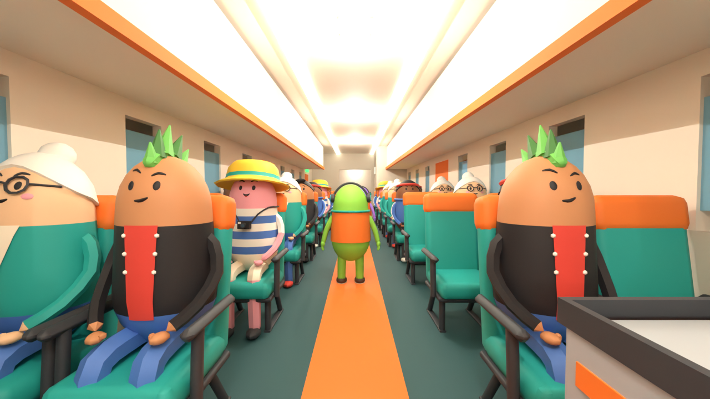
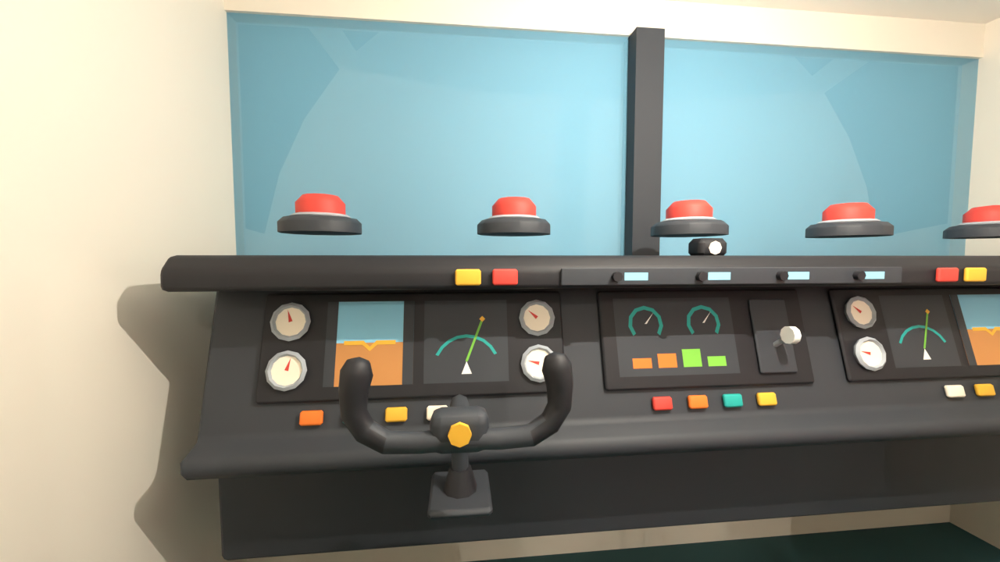
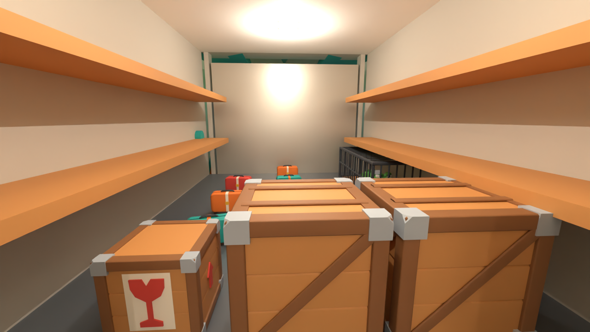
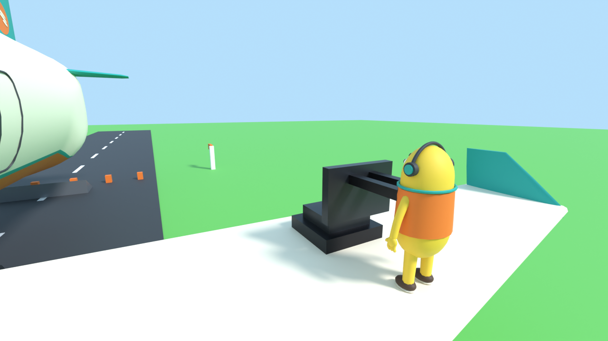
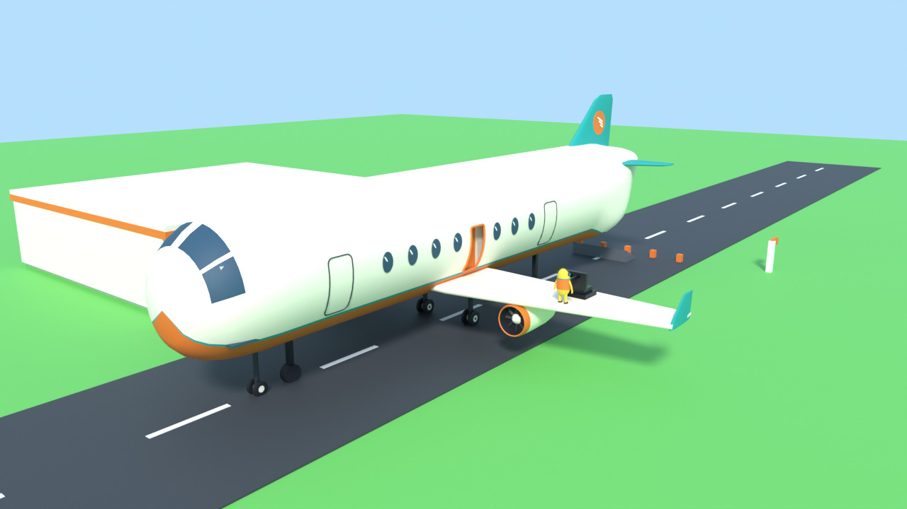

# Overbooked!

Juego cooperativo de 1 a 4 jugadores: la tripulación de la peor aerolínea del mundo. Uno pilota y los demás atienden la cabina: sirven comida y bebida, calman pasajeros, apagan fuegos, tapan agujeros del fuselaje y cuidan de la carga… incluido un cocodrilo.

Todo el código es Luau estricto, sin comentarios. El arte se genera en Blender con scripts y se sube por la API de Open Cloud. El lugar también se construye con Rojo y se publica por la API.

## Vista previa

Montado en Blender con la misma lógica de colocación que usa el juego (`herramientas/vista_previa.py`). En Roblox las ventanas muestran el cielo y el mundo en movimiento; aquí se ve el interior del casco porque Blender dibuja las caras traseras.

## Cómo se juega

1. **Aeropuerto:** apareces en la terminal. En el tablero hay 3 contratos (ruta, distancia, pasajeros, carga, riesgo y pago aproximado). Pulsa **E** en uno de los pedestales para elegirlo.
2. **Embarque (25 s):** suben los pasajeros y se carga la bodega. Entra al avión por la rampa trasera.
3. **Despegue:** alguien se sienta en el asiento izquierdo de la cabina, acelera con **Shift** y, al pasar de 260 km/h, sube con **W**. Si nadie pilota en 45 s, despega el piloto automático.
4. **Vuelo:** mantén el rumbo (el panel dice hacia dónde girar) y la altitud. El piloto automático ayuda, pero se desconecta con los sustos.
5. **Aproximación:** a 140 km del destino el aterrizaje es manual. Hay que llegar a 0 m con menos de 340 km/h, bajando despacio y con las alas rectas.
6. **Resultados:** se cobra por pasajeros entregados (según su satisfacción), carga intacta, entregas aéreas y la calidad del aterrizaje. Se resta por pasajeros perdidos, carga perdida y daños. El dinero se reparte y se guarda.

## Controles

| Acción | Teclado | Mando |
|---|---|---|
| Coger / soltar | Clic | R2 |
| Lanzar | Clic derecho | L2 |
| Usar extintor o llave | F (mantener) | X |
| Interactuar (servir, coger comida, botones, puertas) | E | — |
| Calmar a un pasajero | R (mantener) | — |
| Pilotar: subir / bajar · girar | W / S · A / D | Stick izquierdo |
| Pilotar: más / menos gases | Shift / Ctrl o Q | R2 / L2 |
| Ayuda | H | — |

## Sistemas

| Sistema | Archivo | Qué hace |
|---|---|---|
| Partida | `src/server/Partida.luau` | Aeropuerto → embarque → vuelo → resultados, contratos y cobro |
| Vuelo | `src/server/Avion.luau` | Simulación a 10 Hz, piloto y automático, motores, combustible, casco, rampa, puertas y botones |
| Pasajeros | `src/server/Pasajeros.luau` | Pedidos 🍔 ☕ 💧 con paciencia, miedo y satisfacción (cada bandeja lleva 3 hamburguesas); salen volando si no llevan cinturón |
| Carga | `src/server/Carga.luau` | Daños por golpes, cajas frágiles, entregas aéreas desde la rampa y el cocodrilo |
| Peligros | `src/server/Peligros.luau` | Turbulencias, pájaros que incendian un motor, fuego que se extiende, agujeros que succionan, caída libre, tormenta y fallo de motor |
| Agarrar | `src/server/Agarre.luau` + `src/client/Agarre.luau` | Física con propiedad de red para quien sostiene; se puede coger a pasajeros y lanzarlos por la puerta |
| Personajes | `src/server/Personajes.luau` + `src/client/Cuerpo.luau` | Tripulante como StarterCharacter, color por jugador, ragdoll, caídas del avión, viento en las alas |
| Cámara | `src/client/Camara.luau` | Primera persona con brazos visibles, balanceo al andar, inclinación con el avión y sacudidas |
| Mundo | `src/client/Mundo.luau` | El avión no se mueve: nubes, campos y pista se mueven a su alrededor en cada cliente |
| Interfaz | `src/client/Interfaz.luau` | Ruta y progreso, panel del piloto, estado del avión, avisos, burbujas de pedidos, nombres con 🔊, tablero de contratos y resultados |
| Boca con voz | `src/client/BocaVoz.luau` | La boca del tripulante se abre según el volumen del chat de voz |
| Datos | `src/server/Datos.luau` | Dinero y vuelos en DataStore, con bloqueo de sesión para no pisar datos al cambiar de servidor |
| Piratas | `src/server/Piratas.luau` + `src/client/Piratas.luau` | Aviones pirata que dañan el casco; se derriban desde la torreta del ala izquierda |

Todos los números del juego están en `src/shared/Config.luau`.

## Carpetas

| Carpeta | Qué hay |
|---|---|
| `src/` | Código (servidor, cliente y compartido) |
| `mapa/` | Avión y aeropuerto en piezas de Roblox, generados por `herramientas/generar_mapa.py` |
| `arte/` | Modelos de Blender (tripulante, avión, pasajeros, objetos) con sus generadores, FBX, renders y manifiestos |
| `arte/ids_roblox.json` | IDs de los modelos subidos a Roblox |
| `herramientas/` | Scripts: mapa, subida de modelos y generación de `src/shared/Visuales.luau` |

## IDs en Roblox

| Qué | ID |
|---|---|
| Experiencia (universo) | `10774639088` |
| Lugar principal | `70554923634533` |
| Grupo dueño | `783757619` |
| Tripulante v2 | `87418247604950` |
| Resto de modelos (30: avión, pasajeros, cocodrilo y objetos) | `arte/ids_roblox.json` |

## Flujo de trabajo por API

1. Generar el mapa: `python3 herramientas/generar_mapa.py`
2. Subir modelos nuevos: `python3 herramientas/subir_modelos.py arte/ids_roblox.json ruta/Modelo.fbx …`
3. Regenerar los visuales: `python3 herramientas/generar_visuales.py`
4. Construir: `rojo build default.project.json -o overbooked.rbxlx`
5. Publicar: `POST https://apis.roblox.com/universes/v1/10774639088/places/70554923634533/versions?versionType=Published` con el archivo `.rbxlx`
6. Probar en un servidor de Roblox: `python3 herramientas/probar.py` ejecuta `herramientas/pruebas/servidor.luau` con la API de ejecución de Luau. Comprueba cómo se importó el tripulante (Humanoid, HumanoidRootPart, huesos de la boca, articulaciones), cuántos modelos de Blender se han colocado, si cargó el casco y la fase de la partida. Necesita el permiso *Luau Execution Sessions*.

## Boca que se abre al hablar por voz

Cada cliente conecta el `AudioDeviceInput` de cada jugador a un `AudioAnalyzer` y mueve los huesos `BocaSup` y `BocaInf`. La boca se abre del todo a −12 dB y queda cerrada por debajo de −46 dB. Hace falta tener la voz activada en la configuración del juego (Comunicación). Rojo ya pone `VoiceChatService.UseAudioApi = Enabled`.

## Pendiente

- **Probar en el servidor por API:** la clave aún no tiene el permiso *Luau Execution Sessions* (escritura), así que no he podido arrancar el juego en un servidor de Roblox. Lo que sí está comprobado: todo el código pasa el analizador de tipos de Luau en modo estricto, dos revisiones de código de Roblox (sus hallazgos están corregidos) y la vista previa en Blender del mapa con todos los modelos colocados.
- **Orientación de los modelos:** cómo importa Roblox los FBX por API no se puede comprobar sin ese permiso. El código detecta solo los ejes de cada modelo. Si los asientos o los pasajeros salen mirando hacia atrás, se corrige con `Config.ROTACION_FBX = CFrame.Angles(0, math.pi, 0)`.
- **Tripulante:** si el modelo importado no trae `Humanoid` o `HumanoidRootPart`, el juego usa personajes por defecto y lo avisa en la consola del servidor.
- **Sonidos:** ElevenLabs no es accesible desde esta sesión. El juego aún no tiene sonidos.
- **Del tráiler, no hecho todavía:** escalar el fuselaje con piolet, vehículo de equipaje en tierra e inspección de aduanas.
