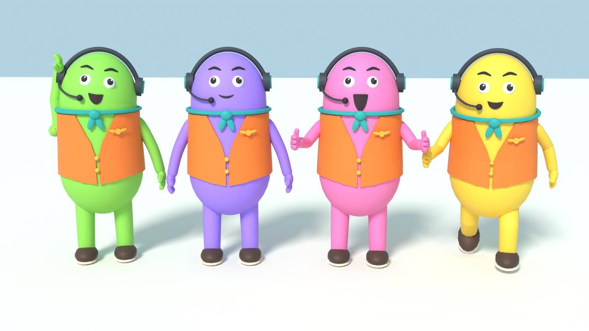
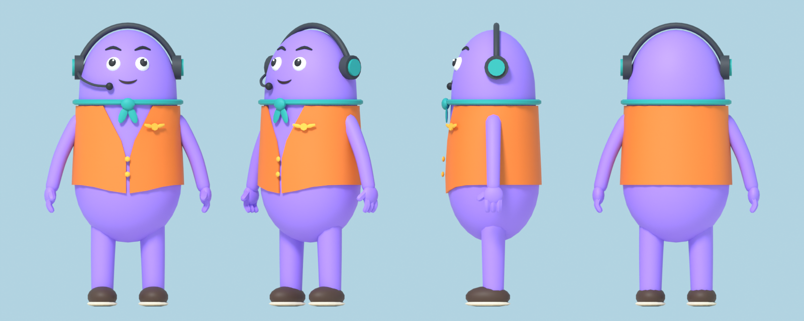
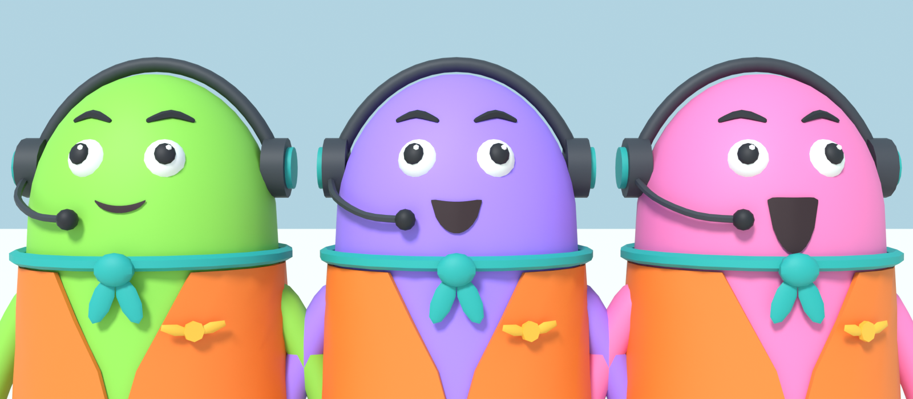
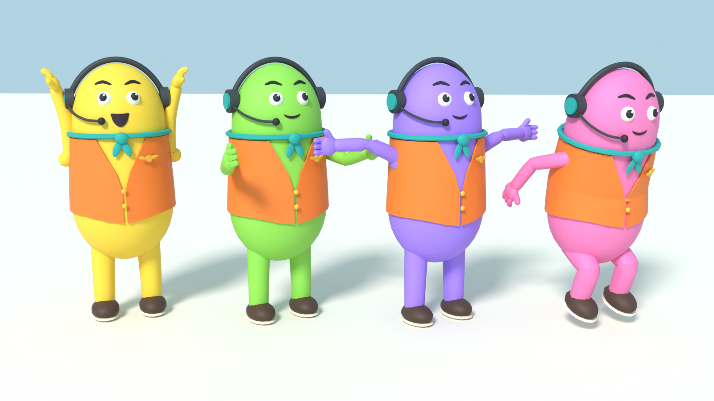

# Tripulante v2

Personaje jugable de la tripulación. Estilo indie: cuerpo cápsula delgado, ojos esféricos y boca que se abre al hablar por voz. Diseño propio de la aerolínea.






## Cambios de la v2

- Cuerpo más delgado (un 15 % menos ancho) y más alargado.
- Ojos esféricos blancos con pupila y brillo.
- Boca con dos huesos (`BocaSup` y `BocaInf`) para abrirse con el volumen de la voz.
- Brazos y manos más finos y separados del cuerpo, con más resolución en el codo y una transición de pesos más suave.

## Archivos

| Archivo | Para qué |
|---|---|
| `tripulante.blend` | Escena de Blender con el esqueleto y las 15 mallas. Ábrela para retocar. |
| `tripulante.fbx` | El que se importa en Roblox Studio. Lleva la textura dentro. |
| `tripulante_palette.png` | Textura de paleta de 64×64 (una casilla por color). |
| `tripulante_gen.py` | Script que genera todo desde cero (modelo, esqueleto, pesos, FBX y renders). |
| `renders/` | Imágenes de referencia. |

## Especificaciones

- **Altura:** 4,67 studs con los auriculares.
- **Esqueleto:** R15 con huesos, jerarquía oficial de Roblox: `Root → HumanoidRootNode → LowerTorso → …`. Root en el origen y LowerTorso en el mismo punto que HumanoidRootNode, como pide la especificación. Además, dos huesos extra hijos de `Head` para la boca: `BocaSup` y `BocaInf`.
- **Mallas:** 15 objetos con los nombres oficiales (`Head_Geo`, `UpperTorso_Geo`, …), todos con pesos. Como mucho 2 huesos por vértice (el límite es 4).
- **Pose:** brazos abajo (pose I).
- **Triángulos:** 7.856 en total, dentro de los límites oficiales de Roblox para cuerpos de avatar:

| Pieza | Triángulos | Límite |
|---|---|---|
| Cabeza | 2.820 | 4.000 |
| Torso | 1.724 | 1.750 |
| Cada brazo | 952 | 1.248 |
| Cada pierna | 704 | 1.248 |

El cuerpo que queda tapado por el chaleco está borrado, así que no gasta triángulos.

## Color del jugador

La casilla "piel" de la paleta es transparente. En Roblox, lo transparente de la textura deja ver el `Color` de la MeshPart, así que el color de cada jugador se cambia poniendo el mismo `Color` a las 15 partes del cuerpo. El resto (chaleco, pañuelo, auriculares, zapatos y cara) sale siempre igual.

En Blender, el color se cambia en el nodo `PlayerColor` del material.

| Casilla | Color |
|---|---|
| 0 | Transparente (color del jugador) |
| 1 | Negro cara `#1B1B21` |
| 2 | Chaleco naranja `#F27B2B` |
| 3 | Turquesa `#1FA6A0` |
| 4 | Gris auriculares `#34383F` |
| 5 | Dorado `#F0B73A` |
| 6 | Crema `#FFF4E0` |
| 7 | Zapato `#4A3428` |
| 8 | Suela `#EDE3CF` |
| 9 | Blanco ojos `#F7F7F2` |
| 10 | Interior boca `#2B1219` |

## En Roblox

Subido con la API de assets al grupo del juego: modelo `87418247604950`. Si alguna vez hay que importarlo a mano en Studio:


1. Abre el importador 3D y elige `tripulante.fbx`.
2. En **Rig Type** deja **R15 / Default**.
3. Si sale mirando hacia atrás, cambia **World Forward** en el importador. Si sale con un tamaño raro, revisa la unidad de escala: 1 unidad de Blender = 1 stud.
4. Para jugar con él, llama al modelo `StarterCharacter` y ponlo en `StarterPlayer`.

## Regenerar

```
blender -b -P tripulante_gen.py -- --render .
```

Sin `--render` solo genera el `.blend`, el `.fbx` y la paleta, en unos segundos. Con `--render` también hace las imágenes (≈ 3 min en CPU).

## Pendiente de probar

No he podido abrir Roblox Studio desde aquí. El FBX está comprobado reimportándolo en Blender (esqueleto, 15 mallas, pesos y textura), pero falta probarlo dentro de Studio. Lo más importante es comprobar que, al importarlo como R15, Roblox conserva los huesos `BocaSup` y `BocaInf` dentro de la cabeza.
