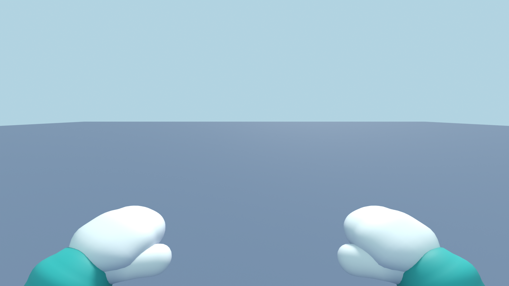
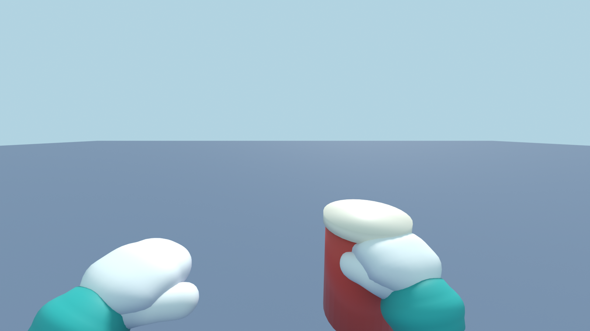
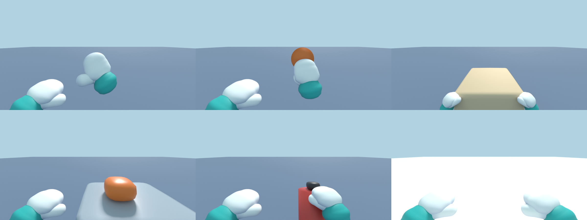
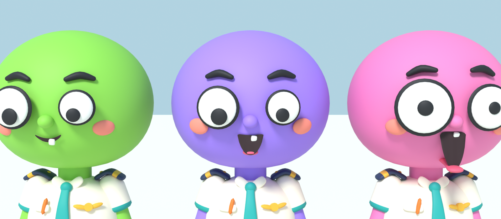
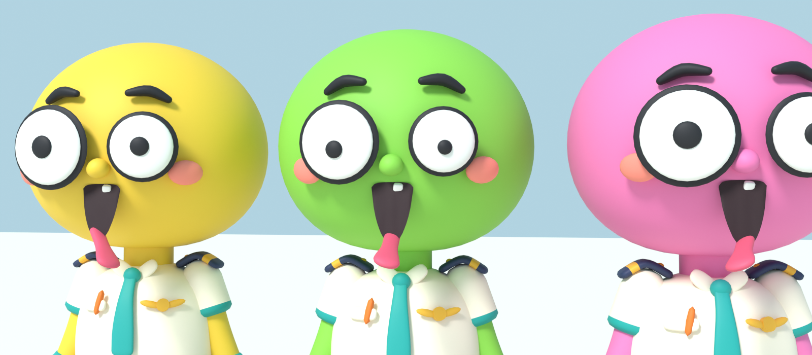
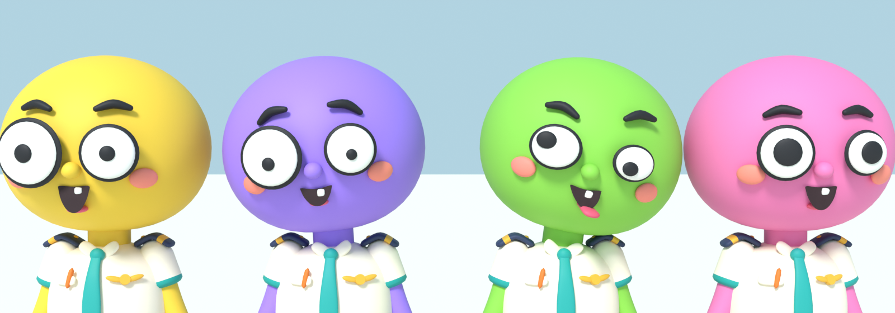
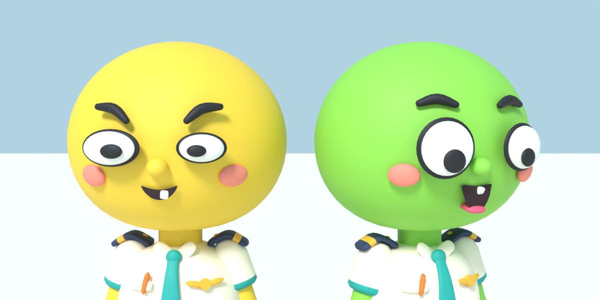
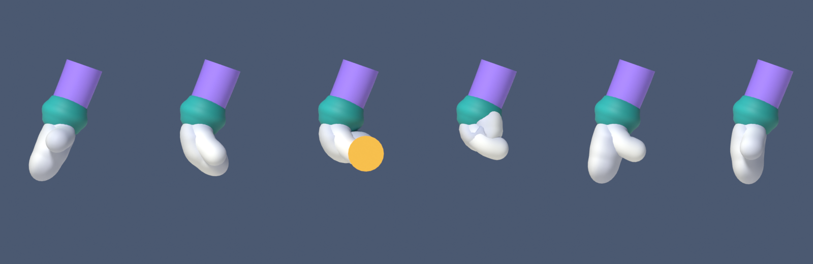
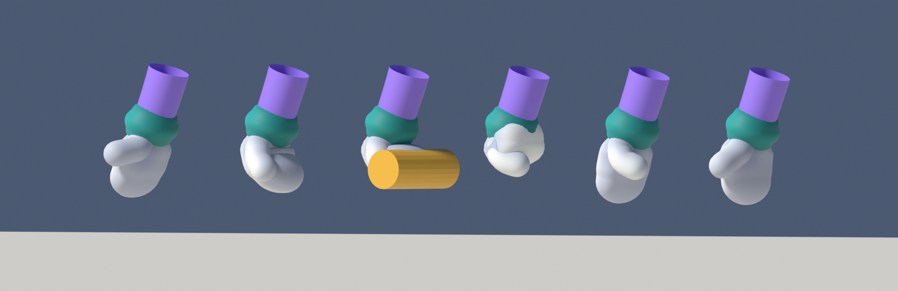

# Tripulante v6

Personaje jugable de la tripulación. Estilo blando, redondo y liso: cabeza grande casi esférica (algo aplastada y más llena abajo, como un bollo) sobre un cuerpo bajito y rechoncho, bracitos y piernas cortas. Va de piloto de la peor aerolínea del mundo: camisa blanca de manga corta, hombreras azul marino con dos galones dorados, corbata turquesa, alas doradas en el pecho y un boli naranja en el bolsillo, cinturón marrón con hebilla dorada, pantalón corto azul marino (uniforme de verano de aerolínea low cost), calcetines altos blancos con rayas turquesa y naranja, botas negras gordotas y manoplas blancas con puño turquesa. La cabeza, los brazos y las rodillas son del color del jugador. Diseño propio.














## Manoplas nuevas (v6.1)

- Manopla de pala ancha y algo plana (0,37 de ancho, 0,21 de grueso, antes 0,34 y 0,24), con los dedos un poco curvados hacia la palma, pulgar gordito con la punta abombada y puño turquesa más fino y abombado (un rollo blando con las puntas redondas). El puño y la muñeca de la manopla dejan 0,04 studs de hueco entre sí.
- Sombra pintada en la paleta: dos casillas nuevas con degradado (14 manoplas, 15 puños). Cada vértice coge la fila de su casilla según lo que mira hacia el dorso: el dorso queda casi blanco y los lados, la palma, la base del pulgar y la entrada del puño se oscurecen hacia un gris azulado. Vista desde el dorso en primera persona, la manopla tiene el borde más oscuro.
- Mismos huesos y mismo `AGARRE_MANO`. 4.176 triángulos por mano (antes 2.588).
- `tripulante_gen.py` ya pasa `separar_capas` a las 15 mallas antes de exportar, y `auditar_solapes.py` sigue dando 0 ALTA, 0 MEDIA y 0 BAJA.

## Cambios de la v6

- Cuerpo nuevo, bajito y redondo: 3,93 studs (antes 5,08). Cabeza de 1,96 de ancho, 1,72 de alto y 1,82 de fondo, centrada en 3,03; cuerpo de 0,70 a 2,13 con barriga; piernas de 0,75 (cadera a 0,95) y brazos que llegan a la cadera. Se nota un poquito de cuello entre el cuello de la camisa y la cabeza.
- Todo liso: más segmentos (cabeza de 44 lados, manoplas de 28) y normales suaves, sin facetas en primera persona. Sin solapes: `auditar_solapes.py` no encuentra caras paralelas a menos de 0,04 studs (0 ALTA, 0 MEDIA, 0 BAJA).
- Manoplas con pulgar en vez de guantes de cinco dedos: 4 huesos por mano (`DerManopla1`, `DerManopla2`, `DerPulgar1`, `DerPulgar2` y lo mismo con `Izq`). Se fueron los 20 huesos de los dedos.
- Cara más pequeña y mona con las mismas piezas que se mueven: boquita con un diente, lengua, cejas, coloretes (casilla nueva `blush`) y nariz de botón.
- Lengua nueva: plana, más ancha en la punta y larga (0,5 studs, casi toda escondida dentro de la cabeza), pesada entera a `Lengua` sin estirarse. Su hueso nace en el labio de abajo, así que gira alrededor de la boca y puede salir 0,4 studs sin despegarse de dentro. Los ojos siguen siendo las piezas saltonas de `Ojos.luau`.
- Sin auriculares (la gorra de piloto es un accesorio de la tienda, `GorraPiloto`).
- Hombreras con galones sobre los hombros, pesadas a medias entre `UpperTorso` y el brazo para que sigan un poco al hombro.
- El uniforme no se monta en capas: el cuerpo es una sola pieza que cambia de color en el cinturón, y la pierna una sola que cambia de color en el calcetín (rayas incluidas). Lo que va encima (corbata, hombreras, alas, cinturón) sobresale 0,03 studs o más.

## Cara en el juego

`src/client/Cara.luau` mueve los huesos con `Bone.Transform` en cada `PreSimulation`, para todos los jugadores a menos de 120 studs (no lo hace con tu propia cabeza en primera persona). Los desplazamientos están en el espacio de la pieza `Head` y se pasan al del hueso con su rotación de reposo, así que no dependen de cómo orienta Roblox cada hueso. Son los mismos números que `cara()` de `tripulante_gen.py` (no han cambiado con la v6):

| Hueso | Movimiento (studs, en la cabeza: X derecha, Y arriba, −Z delante) |
|---|---|
| `BocaSup` | sube 0,065 × apertura (lleva el diente) |
| `BocaInf` | baja 0,25 y sale 0,06 × apertura |
| `Lengua` | gira alrededor del labio y luego sale hacia donde apunta (`CFrame.fromEulerAnglesYXZ(...) * CFrame.new(...)`): al hablar asoma (0,07 × apertura) y se menea poco; al gritar mucho sale 0,4, cae 0,45 rad y aletea de lado como un perro con la cabeza por la ventanilla |
| `CejaIzq`/`CejaDer` | suben 0,06 × cejas; giran ±22° (enfado: extremo interior abajo) y se adelantan al bajar |
| `MejillaIzq`/`MejillaDer` | los coloretes se inflan hacia fuera y delante |
| `Nariz` | se bambolea con la aceleración de la cabeza y olisquea |

**Grito con lengua al viento:** si el nivel de voz pasa de 0,75 durante más de 0,4 s, o con la expresión «Grito» (cayendo deprisa), un muelle (`flop`) lleva la lengua fuera: cae, aletea a ±0,8 rad, se retuerce, la boca se abre del todo, los mofletes se inflan, las cejas suben, los ojos crecen un 30 % con las pupilas pequeñas y tiemblan. Al acabar el grito la lengua vuelve con un muelle poco amortiguado, así que entra con un rebote. Solo son transformaciones de huesos, igual para todos a menos de 120 studs. En `cara()` del generador es el parámetro `flop` (con `fase` para el aleteo).

Los ojos se colocan con `CENTRO = (0.336, 1.059, -0.89)` y `NORMAL = (0.166, -0.028, -0.986)` en el marco de reposo del `HumanoidRootPart` (en `Ojos.luau` y, para la vista previa de la tienda, `OJO_CENTRO`/`OJO_NORMAL` en `Tienda.luau`). El generador los imprime al ejecutarse (`OJO CENTRO …`).

## Primera persona

El importador pone el centro del `HumanoidRootPart` 1 stud por encima de las caderas (1,95 sobre el suelo, `HipHeight` = 0,963) y la cámara de Roblox va a raíz + 1,5 y 0,5 por detrás (el zoom mínimo). `src/client/Camara.luau` pone `Humanoid.CameraOffset = (0, -0.44, 0)` para que vaya a la altura de los ojos (3,01). Sentado, el `SeatWeld` de Roblox pone la raíz 1,214 sobre el asiento (las caderas a 0,21, justo el radio del muslo), así que no hace falta bajar nada.

En tu propia vista no se ven los brazos: `Camara.luau` deja los antebrazos y los brazos con el `LocalTransparencyModifier` que les pone Roblox en primera persona (1) y solo enseña las manos. Cada manopla se coloca en el espacio de la cámara: en `PreSimulation` calcula la cadena `HumanoidRootPart → Root → Waist → hombro → codo` (hombro y codo sin girar) y pone en `RightWrist`/`LeftWrist` el `Transform` que lleva la mano justo ahí. Para que la cadena no cambie a mitad de fotograma, `Movimiento.luau` deja `Root` y `Waist` quietos en tu propia vista (el torso no se ve). Si la cámara no está en los ojos (cinemáticas, cámara libre) o estás en tercera persona, vuelven los brazos normales.

Las posturas son la tabla `VISTA` (en `Camara.luau` y en `tripulante_gen.py`): x e y como fracción de media pantalla a esa profundidad, profundidad z, y en grados cabeceo (dedos hacia arriba), guiñada hacia dentro, alabeo sobre los dedos e inclinación en la pantalla. La izquierda es el espejo de la derecha. La profundidad se escala con `sqrt(tan 40° / tan(campo / 2))`, así que con el slider de 60 a 100 las manos cambian poco de tamaño y no se salen; el ancho usa el aspecto de la pantalla hasta 16:9, así que en un móvil 19,5:9 quedan igual de separadas.

- **Reposo:** manoplas abajo a los lados, inclinadas hacia dentro, con el dorso hacia la cámara y el puño entrando por el borde de abajo (`primera_reposo.png`). Con los dedos hacia delante se vería el puño de frente, así que todas las posturas suben los dedos unos 50–75° para que el dorso mire a la cámara.
- **Vida:** respiran (balanceo lento distinto en cada mano), botan con los saltitos al andar (la fase de `Movimiento.luau` llega a `Camara.paso`, que también mueve la cámara al mismo ritmo), se quedan atrás al girar la cámara (unos 0,11 studs a 180°/s y vuelven en unos 0,3 s), se mueven con la velocidad (suben al caer, bajan al aterrizar) y no siguen la sacudida de la cámara.
- **Agarrar:** la derecha sale hacia el objeto 0,22 s y vuelve con él. Vasos y herramientas se cogen por detrás, con el dorso a la cámara y el pulgar rodeando el objeto (`primera_agarre.png`); `Manos.separacion` aparta el objeto de la palma su radio menos 0,1 para que la manopla no se meta dentro, y las herramientas van derechas e inclinadas 20° hacia delante. Lo de la palma (`palma`) va sobre la palma (`DESFASE_PALMA` = −0,12) y lo grande se abraza: las dos manoplas se agarran a las esquinas de arriba de la cara cercana del objeto, en un marco que sigue a la cámara solo en horizontal (`abrazo`), así que no se despegan al mirar abajo.
- **Lanzar:** al cargar la mano se va atrás y arriba; al soltar, un golpe hacia delante. **Bofetada:** coge impulso a la derecha y da un manotazo con la palma hacia delante. **Botones** (`Botones` llama a `Manos.pulsar`): empuja con la palma hacia el centro. **Avisos:** la derecha se estira hacia delante.
- **Contorno:** un `Highlight` local en cada mano (solo contorno, azul marino al 35 %) para que se lean sobre suelos claros. Se apaga en tercera persona.

Los demás te ven con brazos normales y lo que llevas en la mano: `Camara.luau` mueve en su cliente el hombro (arriba y hacia dentro) y el codo de tu personaje hasta que el punto de agarre de la manopla toca el objeto (en Studio, con un muñeco, queda a 0,01–0,05 studs en las posturas normales). Con el ajuste de tercera persona, en el ragdoll, en el tractor y en el modo clip, tu personaje usa también los brazos normales.

`primera_persona()` del generador hace los renders con la cámara del juego (ojos a 3,01, 0,5 por detrás, 80° de campo vertical, mirando 10° abajo) y los mismos números. Con `--rapido` va a media resolución; con `--encuadre --fov 60` (o 100) y `--aspecto 2.1667` comprueba el encuadre.

## Manoplas en el juego

`src/client/Manos.luau` gira los huesos de las manoplas con `Bone.Transform` en cada `PreSimulation`. La manopla se dobla en dos sitios (nudillo y punta) hacia la palma y el pulgar se cierra hacia ella y se abre hacia delante. Las posturas son 5 ángulos en grados (manopla 1 y 2, pulgar 1 y 2, apertura del pulgar), los mismos que `POSES_MANO` de `tripulante_gen.py`. En tu propia vista las manos en reposo usan `primera` (menos cerradas) y al sujetar un vaso o una herramienta `sosten` (para que la manopla no se quede en un muñón visto por detrás). Tu propio personaje usa lo que tienes en la mano según `Agarre` (`Manos.sostener`), sin esperar al atributo del servidor. Si a un personaje le faltan huesos, esa parte de la mano no se mueve.

Roblox borra al importar los huesos que no tienen ningún vértice, así que el punto de agarre no es un hueso: está a `(-0.199, -0.123, 0)` de `DerManopla1` en el espacio de `RightHand` (el `AGARRE` del generador; lo imprime como `AGARRE_MANO`).

## Dónde van los accesorios

Medidas en el espacio de la pieza `Head` (centro de su caja; `Head.Size` = 1,96 × 2,17 × 1,919; en Blender el centro está en (0, −0,048, 2,845)):

- **Gorros:** la cabeza acaba arriba en Y 1,085. Por delante no deben bajar de Y ≈ 0,675: las cejas están en Y 0,50 y al gritar suben hasta Y ≈ 0,62. A la altura del borde de los gorros (Y 0,7) la cabeza mide unos 0,76 de radio a lo ancho y 0,74 a lo hondo.
- **Gafas:** los ojos están en X ±0,336, Y 0,164, Z −0,842, con el frente de la pupila en Z ≈ −1,03 y un radio de 0,24 (el ojo grande; 0,31 en sorpresa). Unas gafas van por delante, a 0,25 del centro del ojo (Z ≈ −1,09), con cristales de radio 0,27 o más.
- **Libre:** la boca (Y −0,17, se abre hasta −0,46, ancho ±0,14), la nariz (Y 0,015, sobresale hasta Z ≈ −0,98) y los coloretes (X ±0,56, Y −0,08). Los lados de la cabeza (X ±0,98) están libres para auriculares.
- **Espalda:** en el espacio de `UpperTorso` (`Size` = 1,258 × 0,896 × 0,961, centro en (0, −0,027, 1,757)), la espalda de la camisa está en Z ≈ +0,47; una mochila va en `(0, -0.06, 0.47 + fondo / 2)` y no debe pasar de Y +0,35 (ahí empieza la cabeza). Las hombreras están encima de los hombros, de X ±0,29 a ±0,59, Y ≈ +0,35.

## Archivos

| Archivo | Para qué |
|---|---|
| `tripulante.blend` | Escena de Blender con el esqueleto, las 15 mallas y los ojos de los renders (ocultos, no se exportan). Ábrela para retocar. |
| `tripulante.fbx` | El que se importa en Roblox Studio. Lleva la textura dentro. |
| `tripulante_palette.png` | Textura de paleta de 64×64 (una casilla por color). |
| `tripulante_gen.py` | Script que genera todo desde cero (modelo, esqueleto, pesos, FBX y renders). |
| `ids_subida.json` | Id del modelo subido. |
| `renders/` | Imágenes de referencia. |

## Especificaciones

- **Altura:** 3,93 studs (`Config.ALTURA_TRIPULANTE`). Bajito a propósito: la distancia de la cadera a los ojos (2,06) es casi la de la v5 (2,14), así que sentado en la cabina los ojos quedan por encima del cuadro de mandos y se ve por el parabrisas; de pie ves por encima de los mostradores bajos y los dispensadores de la cocina te quedan a la altura de la cara.
- **Esqueleto:** R15 con huesos, jerarquía oficial de Roblox: `Root → HumanoidRootNode → LowerTorso → …`. Root en el origen y LowerTorso en el mismo punto que HumanoidRootNode (1,05). Cintura a 1,32, cuello a 2,12, hombros en (±0,47, 1,92), codos en (±0,58, 1,56), muñecas en (±0,70, 1,26), caderas en (±0,25, 0,95), rodillas en (±0,26, 0,55) y tobillos en (±0,27, 0,20). Además, 8 huesos de cara y 8 de manoplas (33 en total; en Roblox quedan 16 porque los del cuerpo se convierten en piezas).
- **Mallas:** 15 objetos con los nombres oficiales (`Head_Geo`, `UpperTorso_Geo`, …), todos con pesos. Como mucho 3 huesos por vértice (el límite es 4).
- **Pose:** brazos un poco abiertos (17°) para no rozar la barriga.
- **Triángulos:** 27.480 en total (es un StarterCharacter propio, no un avatar UGC):

| Pieza | Triángulos |
|---|---|
| Cabeza | 5.136 |
| Torso de arriba / de abajo | 4.144 / 1.800 |
| Cada brazo (arriba, abajo, manopla) | 868 + 340 + 4.176 |
| Cada pierna (muslo, pierna, bota) | 844 + 460 + 1.512 |

## Color del jugador

La casilla "piel" de la paleta es transparente. En Roblox, lo transparente de la textura deja ver el `Color` de la MeshPart, así que el color de cada jugador se cambia poniendo el mismo `Color` a las 15 partes del cuerpo. Son de piel la cabeza, el cuello, la nariz, los brazos y las rodillas; el resto (uniforme, manoplas, calcetines, botas y cara) sale siempre igual.

En Blender, el color se cambia en el nodo `PlayerColor` del material.

| Casilla | Color |
|---|---|
| 0 | Transparente (color del jugador) |
| 1 | Negro cara `#1B1B21` |
| 2 | Naranja boli y raya del calcetín `#F27B2B` |
| 3 | Turquesa corbata, puños y rayas `#1FA6A0` |
| 4 | Suela `#4A3F3A` |
| 5 | Dorado galones, alas y hebilla `#F0B73A` |
| 6 | Camisa `#FFF4E0` |
| 7 | Cinturón `#5A3B2A` |
| 8 | Botas `#2E2A2C` |
| 9 | Blanco diente y calcetines `#F7F7F2` |
| 10 | Interior boca `#2B1219` |
| 11 | Lengua `#E85A78` |
| 12 | Azul marino pantalón y hombreras `#2C3A5E` |
| 13 | Coloretes `#FF8F7E` |
| 14 | Manoplas, degradado de `#FAFAF5` a `#A4ABC6` |
| 15 | Puños, degradado de `#2CBAB2` a `#147A75` |

## En Roblox

Subido con la API de assets al grupo del juego: modelo `138009622641677` (`python -I herramientas/subir_modelos.py arte/tripulante/ids_subida.json arte/tripulante/tripulante.fbx`; la v6 era `93486408235562`, la v5 `79935936187714`, la v4 `126872888876091`, la v3 `124975432706541` y la v2 `87418247604950`). Si alguna vez hay que importarlo a mano en Studio:

1. Abre el importador 3D y elige `tripulante.fbx`.
2. En **Rig Type** deja **R15 / Default**.
3. Si sale mirando hacia atrás, cambia **World Forward** en el importador. Si sale con un tamaño raro, revisa la unidad de escala: 1 unidad de Blender = 1 stud.
4. Para jugar con él, llama al modelo `StarterCharacter` y ponlo en `StarterPlayer`.


## Regenerar

```
blender -b -P tripulante_gen.py -- --render <carpeta absoluta>
```

Sin `--render` solo genera el `.blend`, el `.fbx` y la paleta, en unos segundos. Con `--render` también hace las imágenes (≈ 2 min en CPU), con `--manos` solo las dos de las manoplas y con `--primera` las de las manoplas y las de primera persona. La carpeta de salida tiene que ir como ruta absoluta: con `.` Blender no encuentra dónde guardar la paleta.

Si cambia el cuerpo, hay que actualizar a mano: `Config.ASSET_TRIPULANTE` y `Config.ALTURA_TRIPULANTE`, `CENTRO`/`NORMAL` en `Ojos.luau` y `OJO_CENTRO`/`OJO_NORMAL` en `Tienda.luau`, `ALTURA_OJOS` y `VISTA` en `Camara.luau` (y la misma tabla en el generador), `AGARRE_MANO` y `PALMA` en `Manos.luau`, y `PIVOTES`, ojos y medidas de `arte/accesorios/accesorios_gen.py` (y volver a subir los accesorios).

## Probado en Studio

Cargado con `InsertService:LoadAsset`: llegan los 16 huesos (8 de cara y 8 de manoplas), 15 juntas y `HipHeight` = 0,963. Jugando: la cámara a la altura de los ojos y las manoplas en las esquinas en primera persona, la vista en tercera persona, los ojos saltones en su sitio, andar a saltitos, el ragdoll, sentarse en un banco, accesorios de cabeza, cara y espalda y la vista previa de la tienda. Falta verlo con 2 jugadores (cómo ven los demás lo que llevas en la mano) y la cara con voz de verdad.

Manoplas v6.1 (modelo `138009622641677`): en primera persona, reposo, andando, girando, con un café (cogido por detrás, con el pulgar rodeándolo), cargando y soltando un lanzamiento, una caja frágil con las dos manos (agarrada por las esquinas de delante también mirando abajo), una bofetada y el contorno sobre el suelo claro del aeropuerto; en tercera persona (ajuste de cámara) con el café en la manopla y los brazos normales. El ajuste del brazo para los demás se probó con un muñeco clonado; con 2 jugadores de verdad, en un móvil y con el slider de campo en Studio no se ha probado (el encuadre a 60, 100 y 19,5:9 está comprobado con los renders).
